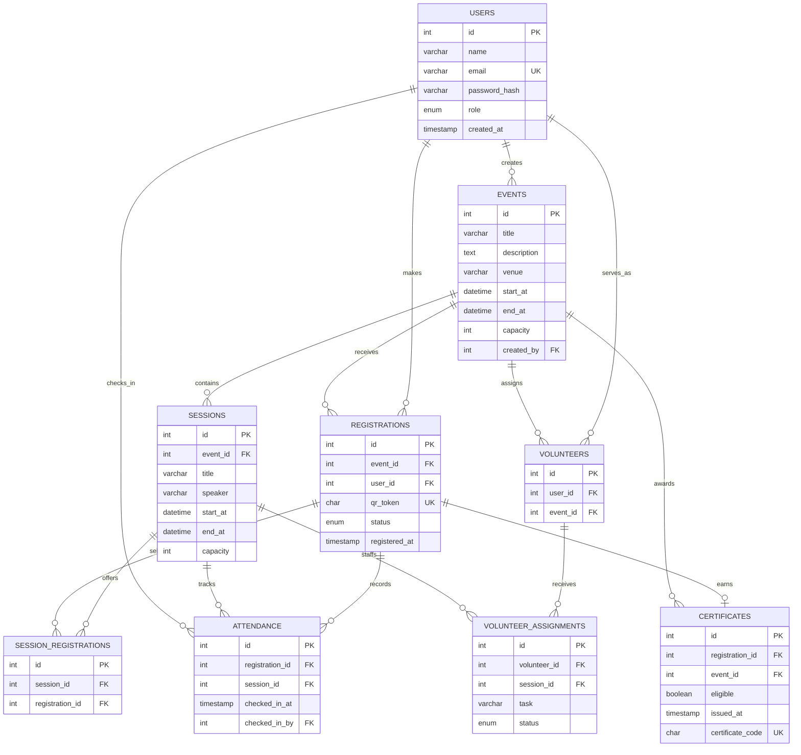

# CampusOps MySQL database

CampusOps uses MySQL 8 with InnoDB tables and `utf8mb4`. Part 1 creates the nine core tables and loads a small demo dataset.

## Setup

Run these commands from the repository root on a local MySQL 8 installation. They prompt for the MySQL root password. `schema.sql` creates and selects the `campusops` database; run it against an empty database because it uses `CREATE TABLE IF NOT EXISTS` and does not drop existing data.

```sh
mysql -u root -p < database/schema.sql
mysql -u root -p < database/seed.sql
```

To inspect seeded row counts:

```sh
mysql -u root -p campusops -e "SELECT 'users' AS table_name, COUNT(*) AS rows_count FROM users UNION ALL SELECT 'events', COUNT(*) FROM events UNION ALL SELECT 'sessions', COUNT(*) FROM sessions UNION ALL SELECT 'registrations', COUNT(*) FROM registrations UNION ALL SELECT 'session_registrations', COUNT(*) FROM session_registrations UNION ALL SELECT 'attendance', COUNT(*) FROM attendance UNION ALL SELECT 'volunteers', COUNT(*) FROM volunteers UNION ALL SELECT 'volunteer_assignments', COUNT(*) FROM volunteer_assignments UNION ALL SELECT 'certificates', COUNT(*) FROM certificates;"
```

## Demo accounts

All seeded accounts use the password `CampusOpsDemo123!` (bcrypt cost 12).

| Role | Email |
| --- | --- |
| Admin | `admin@campusops.test` |
| Organizer | `organizer@campusops.test` |
| Volunteer | `volunteer1@campusops.test`, `volunteer2@campusops.test` |
| Participant | `aditi@campusops.test` and `kabir`, `isha`, `rohan`, `mira`, `dev`, `sara`, `neel`, `tara`, `arjun` at `@campusops.test` |

## Entity relationship diagram


