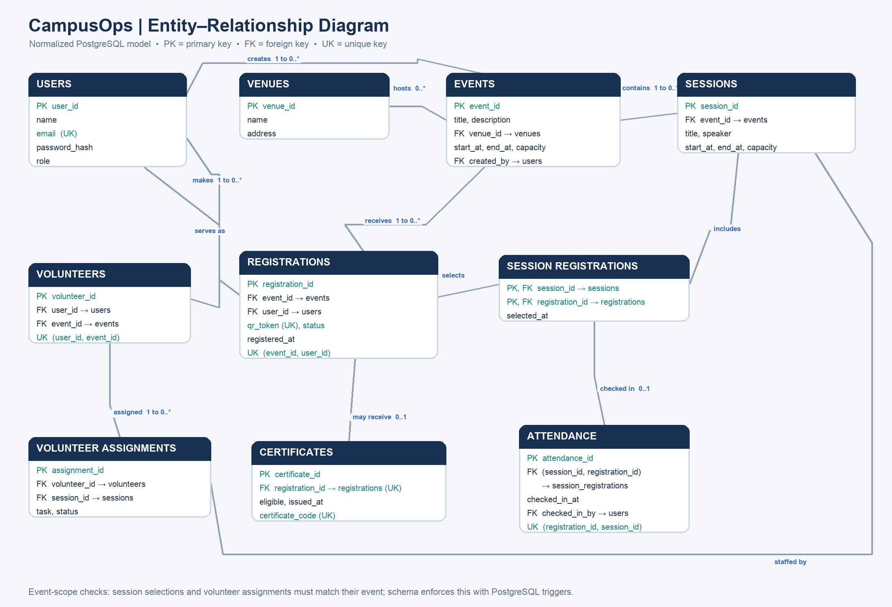
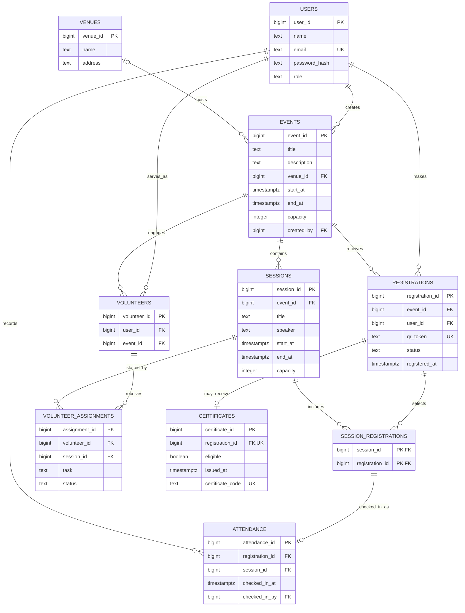

# CampusOps ER Diagram

## Entities and attributes

| Entity | Attributes | Primary key | Foreign keys / alternate keys |
|---|---|---|---|
| User | name, email, password_hash, role | user_id | email UNIQUE |
| Venue | name, address | venue_id | — |
| Event | title, description, start_at, end_at, capacity | event_id | venue_id → Venue; created_by → User |
| Session | title, speaker, start_at, end_at, capacity | session_id | event_id → Event |
| Registration | qr_token, status, registered_at | registration_id | event_id → Event; user_id → User; UNIQUE(event_id,user_id); qr_token UNIQUE |
| SessionRegistration | session_id, registration_id | (session_id, registration_id) | session_id → Session; registration_id → Registration |
| Attendance | checked_in_at | attendance_id | (session_id,registration_id) → SessionRegistration; checked_in_by → User; UNIQUE(registration_id,session_id) |
| Volunteer | user_id, event_id | volunteer_id | user_id → User; event_id → Event; UNIQUE(user_id,event_id) |
| VolunteerAssignment | task, status | assignment_id | volunteer_id → Volunteer; session_id → Session |
| Certificate | eligible, issued_at, certificate_code | certificate_id | registration_id → Registration UNIQUE; certificate_code UNIQUE |

## Relationships and cardinalities

- A **User** may create zero or more **Events**; each event has one creator.
- A **Venue** may host zero or more events; an event has one venue (venue may be optional if the event is online/TBD).
- An **Event** contains zero or more **Sessions**; each session belongs to exactly one event.
- A **User** may have zero or more **Registrations**; each registration belongs to one user and one event. `UNIQUE(event_id,user_id)` prevents repeat registration by that user for that event.
- A **Registration** may select zero or more **Sessions**, and a **Session** may have zero or more registrations. `SessionRegistration` resolves this many-to-many relationship.
- A **Registration** may have zero or more attendance records over different sessions; a **Session** may have zero or more attendance records. Each participant/session pair has at most one check-in.
- A **User** may serve as a **Volunteer** for multiple events. A volunteer record is scoped to one event.
- A **Volunteer** may have zero or more **VolunteerAssignments**; each assignment names one session. A session may have many assignments.
- A **Registration** may have zero or one **Certificate** record under the current one-certificate-per-registration rule.

## Assumptions

1. Registration event and user identity is unique as a pair.
2. Each session is owned by one event. A session registration and volunteer assignment must reference a session in the same event as the registration/volunteer; enforce this with composite scoped foreign keys or database triggers.
3. Attendance requires a corresponding session-registration pair, in addition to referencing a valid check-in user.
4. Venues are reusable resources. Remove the Venue entity only if the team decides location is free-form text with no independent identity or reuse.
5. Session capacity and event capacity are limits, not normalized counters. Use transactional checks for concurrent changes.

## Mermaid ER diagram

